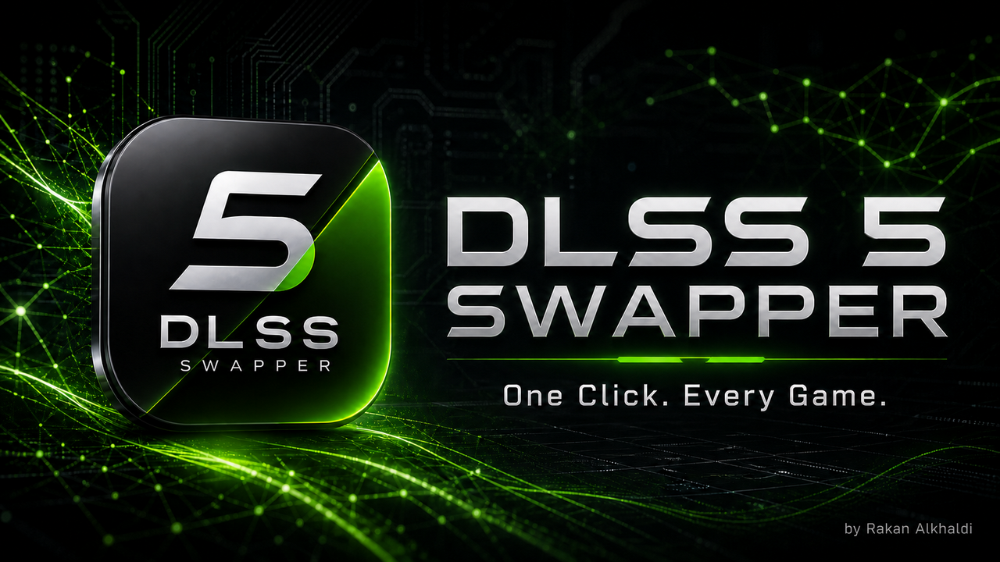
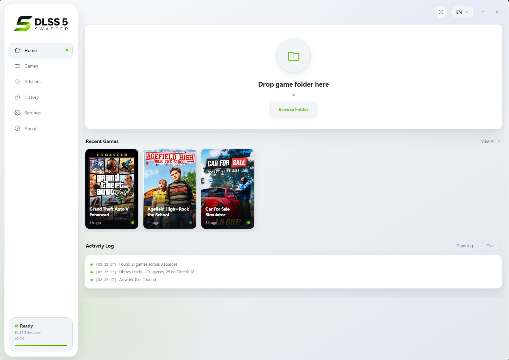
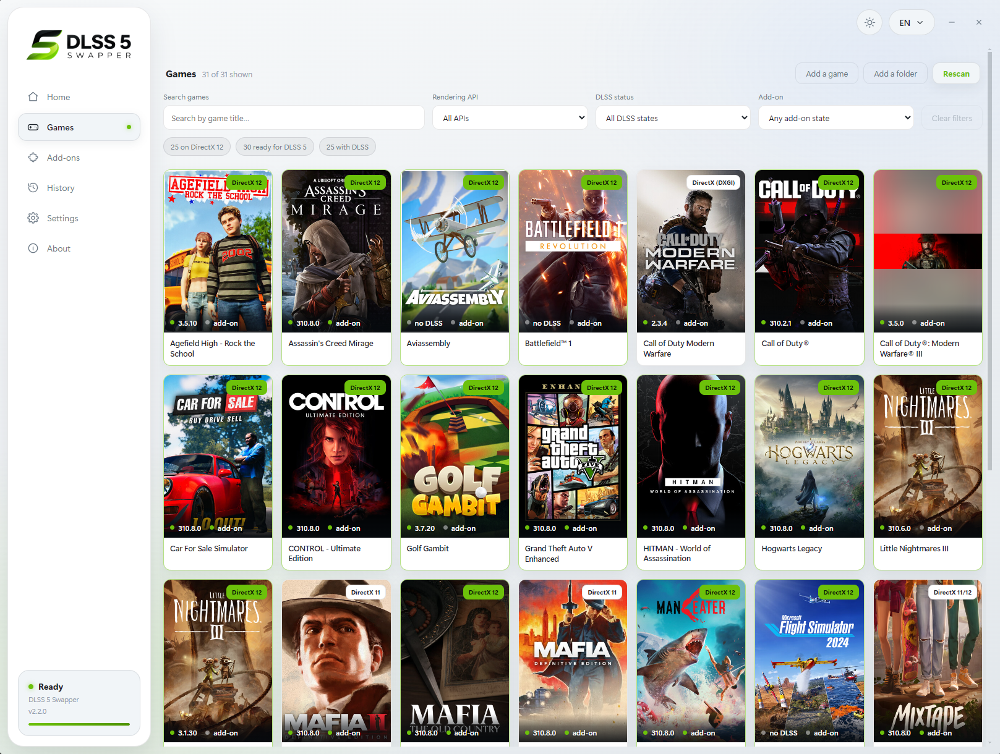
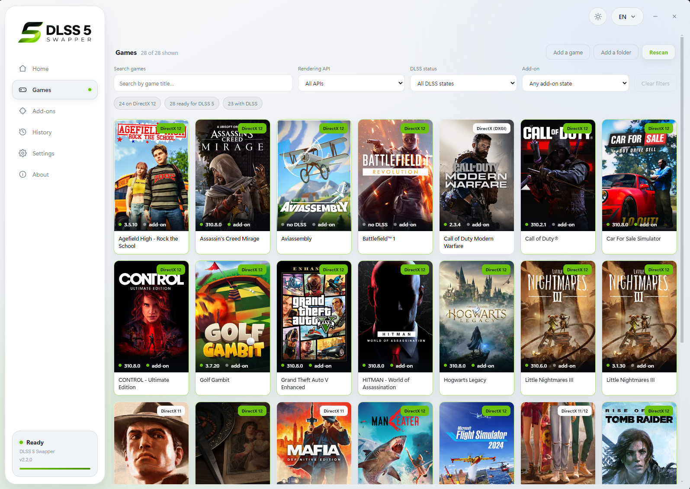
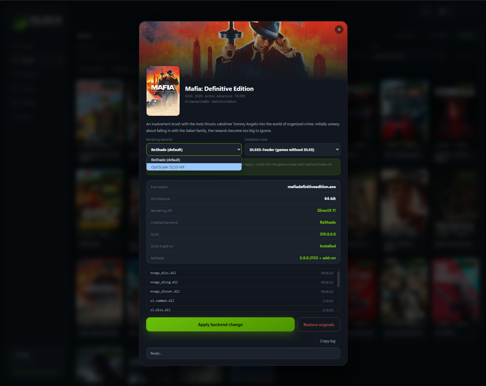
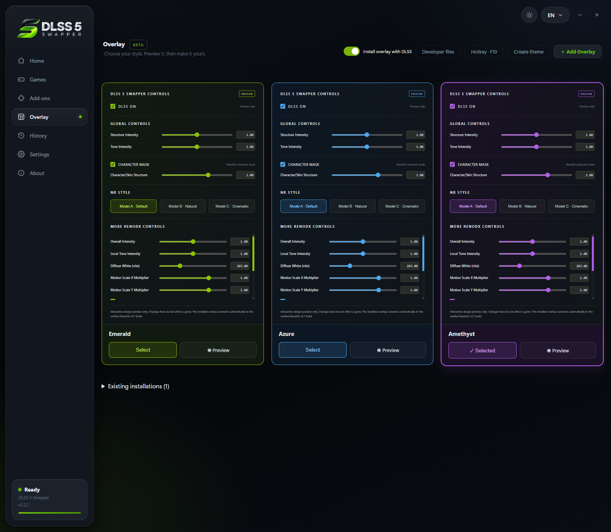

  

<h1 align="center">DLSS 5 Swapper</h1>

  Install and manage DLSS 5 Neural Rendering for compatible games and emulators.

  English · <a href="README.md">简体中文</a>

  
  
  
  

> ## ⚠️ The original author has deleted the upstream repository — this is a preservation of their final release
>
> The upstream repo `rakanki911/DLSS5-Swapper` and the author account **have been deleted from GitHub** (both now return 404). This repository preserves the **last version the original author, Rakan Alkhaldi, published: 2.2.9**. Exactly **one thing** was changed on top of it: **the Simplified Chinese interface translations were completed to 100%**. Functionality, logic, dependencies and behaviour are **untouched** and identical to the author's final build.
>
> That is also why **this is not only for Chinese users**: anyone can use it as an archive of the author's v2.2.9, and the interface language can be switched in Settings (38 languages included). Chinese readers, see [README.md](README.md).

  

## Download

[**Windows Installer**](https://github.com/CBEdwin/DLSS5-Swapper-zh-CN/releases/latest) ·
[**Portable**](https://github.com/CBEdwin/DLSS5-Swapper-zh-CN/releases/latest) ·
[Checksums](https://github.com/CBEdwin/DLSS5-Swapper-zh-CN/releases/latest)

Both are on this repository's release page, with `SHA256SUMS.txt` beside them.

## Features

- **Easy installation:** native DLSS games, or compatible non-DLSS games through DLSS5-Feeder.
- **Your library:** Steam, Epic, GOG, modern Xbox Game Pass folders, and manually added games/emulators.
- **Search and filters:** combine title, graphics API, DLSS status/version and add-ons; click counters to filter.
- **Flexible layout:** group by store or show everything in one list, with game artwork and light/dark themes.
- **Controlled scanning:** full-drive scanning is **off by default**. Added folders still scan normally; enable all-drive discovery or remove scan folders in Settings.
- **Right-click shortcuts:** open/copy folder, rescan, change cover, restore originals or hide a game.
- **Backups and History:** restore original files, keep installation records, and copy History/activity/install logs.
- **Save diagnostics:** one file with the install log, the game’s own ReShade and Feeder logs, the manifest and your driver - shown to you before it is written, and ready to attach to a report.
- **In-game overlay:** press **F8** to open the app's own panel over the running game and move the real DLSS Neural Rendering sliders while you play. Supports the **DLSS5-Feeder** and **RenoDX** routes only, and it knows both RenoDX builds the app ships (6.5.3 and the older 4.7). Drag the grip in its bottom right corner to resize it; each game remembers its own size.
- **Rendering API override:** optional, per game, with **Automatic** as the default; detection is never overwritten.
- **Custom add-ons:** the Add-ons page remains available alongside the integrated installation routes.
- **Multipass neural rendering:** an installation route that runs the neural pass up to ten times per frame, on DX12, DX11 and 64-bit DX9 - including games with no DLSS of their own.
- **Community (BETA):** read what worked for other people, narrowed to the games on your PC and the graphics card in it, leave your own report, and talk it over underneath it. Opt-in, and everything you leave can be edited, deleted or withdrawn.
- **Community chat:** one live room for everyone using the app - screenshots, game cards, replies with mentions and reactions.

## New in 2.2.9

Four faults from the tracker, fixed at the cause. Every one of them was reported by somebody in it.

| | |
|---|---|
| **The installer crashed before it opened** | On some machines the setup died instantly with `0xc0000005`, no window and no prompt, while the portable build was fine. The installer framework read past the end of a path Windows handed it. Fixed upstream, and this release is built with the fixed version (upstream issue #344) |
| **Restore originals went dead with the files still in the game** | A finished restore renames the backup record aside, and everything that decides whether a game has anything installed read only the live one. The app now offers the newest retired record whose files are still in the game, and restores from the same backups (upstream issue #325) |
| **dgVoodoo2 flagged by antivirus** | Upstream released 2.87.5 precisely because engines flag 2.87.4, and the app was pinned to 2.87.4 (upstream issue #390) |
| **ReShade never started in a wrapped DirectX 8/9 game** | Inside dgVoodoo the game is a DirectX 11 one, and some setups load only `d3d11.dll`. The **ReShade file** choice is offered for these games now (upstream issues #343, #374) |

## Earlier releases

Each one is written up in full - what broke, why, and what was changed.

| | |
|---|---|
| **2.2.8** | [A second theme, and every add-on brought current](docs/releases/v2.2.8.md) - a whole second design, DLSS5-Feeder 1.17.0, RenoDX 6.5.3, a second OptiScaler build per game, and ten faults fixed |
| **2.2.7** | [Find the reviews that matter to you](docs/releases/v2.2.7.md) - filter by your card, reviews for your games, notifications, and eight faults fixed |
| **2.2.6** | [Community chat](docs/releases/v2.2.6.md) - one live room for everyone, and the right add-on on every route |
| **2.2.5** | [Multipass](docs/releases/v2.2.5.md) - the neural pass up to ten times per frame, plus nine faults fixed at the cause |
| **2.2.4** | [The Community page](docs/releases/v2.2.4.md) - compare notes with everyone else, plus eight faults fixed at the cause |
| **2.2.3** | [Six reported faults, fixed at the cause](docs/releases/v2.2.3.md) - OptiScaler on older cards, a game's own stale shader compiler, the overlay on a scaled display |
| **2.2.2** | [The reports people sent](docs/releases/v2.2.2.md) - games it could not find, installs it refused, the overlay's own page |
| **2.2.1** | [The Overlay page](docs/releases/v2.2.1.md) - themes you can write yourself, and a preview that runs before you choose |
| **2.2.0** | [Optional OptiScaler and a smarter library](docs/releases/v2.2.0.md) |

Every release also carries its own notes and downloads on the
[releases page](https://github.com/CBEdwin/DLSS5-Swapper-zh-CN/releases).

## Compatibility

| Category | Support |
| --- | --- |
| **System** | Windows 10/11 x64; compatible 32-bit and 64-bit games |
| **ReShade / Feeder GPUs** | RTX 20 / 30 / 40 / 50; older-series support is reported by the bundled modified runtime's author |
| **OptiScaler GPUs** | 64-bit games with native DLSS enabled. The bundled neural model runs on **Blackwell** (RTX 50 / RTX PRO Blackwell); an older card needs a modded `nvngx_dlssnr.dll` you supply, which is never overwritten. Driver **616.56** or newer |
| **DirectX 12** | Native DLSS, Feeder, or eligible OptiScaler games |
| **DirectX 11** | Feeder for 32/64-bit games; eligible OptiScaler games |
| **DirectX 9 / 8** | DX9: 32/64-bit; DX8: 32-bit, through dgVoodoo2 → DX11 → Feeder |
| **Vulkan / OpenGL** | ReShade/Feeder; eligible Vulkan games can also use OptiScaler |
| **DirectX 10** | Not directly supported by Feeder; choose DX11 when available |
| **In-game overlay** | 64-bit DirectX 11 / 12 games with ReShade add-on support; **DLSS5-Feeder and RenoDX only** |

OptiScaler's DX11/Vulkan path uses a DX12 bridge with FSR output by default.
For Vulkan backend changes, **restore originals first**. OptiScaler is not the emulator/non-DLSS route.

## Emulators

Select the emulator folder and its active renderer, then use **ReShade/Feeder**.

<table>
  <tr><th colspan="3">Emulators</th></tr>
  <tr><td>DuckStation</td><td>PCSX2</td><td>RPCS3</td></tr>
  <tr><td>Dolphin</td><td>PPSSPP</td><td>Xenia</td></tr>
  <tr><td>Cemu</td><td>Ryujinx</td><td>yuzu / suyu / Eden / Citron / Sudachi</td></tr>
  <tr><td>shadPS4</td><td>Azahar / Citra / Lime3DS</td><td>melonDS</td></tr>
  <tr><td>Flycast</td><td>xemu</td><td>Vita3K</td></tr>
  <tr><td>RetroArch</td><td>mGBA</td><td>Snes9x</td></tr>
  <tr><td>Play!</td><td></td><td></td></tr>
</table>

Compatibility varies by renderer and game. Xenia HUD correction remains experimental.

## 38 languages

<table>
  <tr><th colspan="4">All 38 languages</th></tr>
  <tr><td>English</td><td>العربية</td><td>简体中文</td><td>繁體中文</td></tr>
  <tr><td>Español</td><td>Português</td><td>Русский</td><td>Deutsch</td></tr>
  <tr><td>Français</td><td>日本語</td><td>한국어</td><td>Italiano</td></tr>
  <tr><td>Türkçe</td><td>Polski</td><td>Українська</td><td>Nederlands</td></tr>
  <tr><td>Čeština</td><td>Magyar</td><td>Română</td><td>Ελληνικά</td></tr>
  <tr><td>Svenska</td><td>Dansk</td><td>Norsk</td><td>Suomi</td></tr>
  <tr><td>ไทย</td><td>Tiếng Việt</td><td>Bahasa Indonesia</td><td>Bahasa Melayu</td></tr>
  <tr><td>Filipino</td><td>हिन्दी</td><td>বাংলা</td><td>فارسی</td></tr>
  <tr><td>اردو</td><td>Български</td><td>Српски</td><td>Hrvatski</td></tr>
  <tr><td>Slovenčina</td><td>Català</td><td></td><td></td></tr>
</table>

**Arabic, Persian and Urdu support right-to-left layout.**

> **Note for Simplified Chinese users:** this repository is an independently maintained Simplified Chinese build of v2.2.9 (not a fork, so it is unaffected by changes to the upstream repository). Upstream's Chinese language pack covers only 16.5% in practice (much of the UI falls back to English); this repository brings it to 100%. See [TRANSLATION.zh-CN.md](TRANSLATION.zh-CN.md) for the change list, upstream sync procedure and licence attribution.

## Screenshots

## Before installing

- **Anti-cheat:** red warning and optional confirmation, not a blanket block. Injection can cause crashes or account bans; the app never bypasses anti-cheat.
- **Requirements:** Feeder needs Visual C++ runtimes (x64, plus x86 for 32-bit games). Some components download on first use.
- **Compatibility is not guaranteed.** Keep backups; existing mods may conflict. Not every reported game crash is fixed.
- **Linux/Proton:** experimental community source only; no Linux binaries in this release.

## Community and privacy

- Opening the Community page downloads public game reports. A live connection
  count is held only in memory; no connection identifiers are stored.
- A report is sent only after you review and submit the fields shown in its
  dialog: game, route, rendering API, result, optional comment, GPU, driver,
  CPU, OS and app version.
- The app uses a random install ID to prevent duplicate votes. The server stores
  only its hash. **Remove my community activity** hides all your reports and
  replies and resets your public community profile.
- The owner-only administrator access code is verified by the community server
  and stored locally with Windows encrypted storage. It is never written to the
  public profile or the normal community settings file.

---

Built by **Rakan Alkhaldi** · MIT · [Third-party credits and licences](THIRD_PARTY_NOTICES.md)

This repository only preserves their final v2.2.9 build with the Simplified Chinese translation completed; no functionality was changed. The author account and upstream repository have both been deleted — contact this repository if anything needs taking down.
