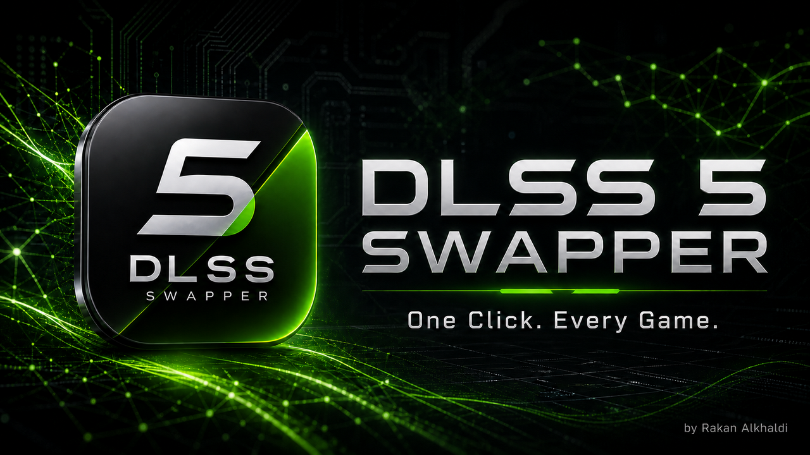
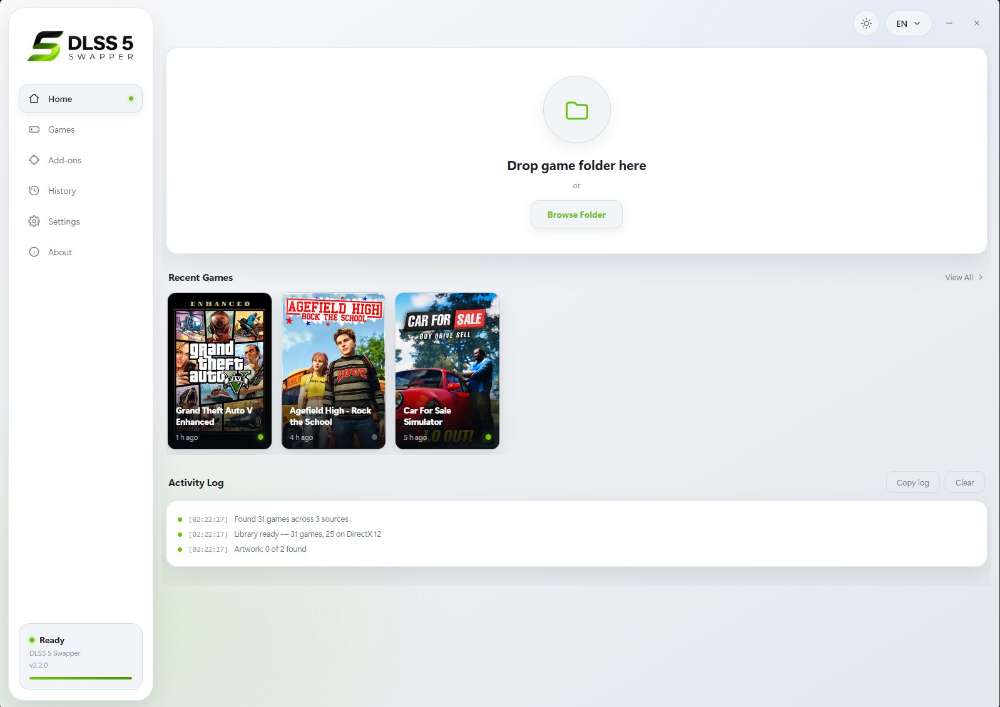
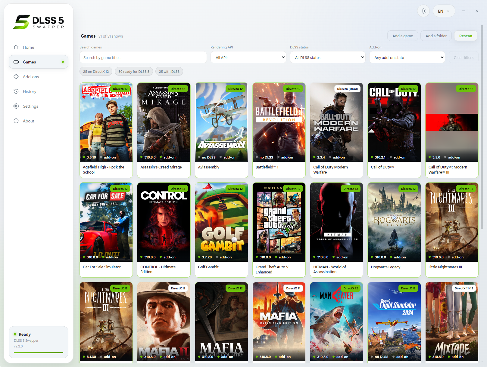
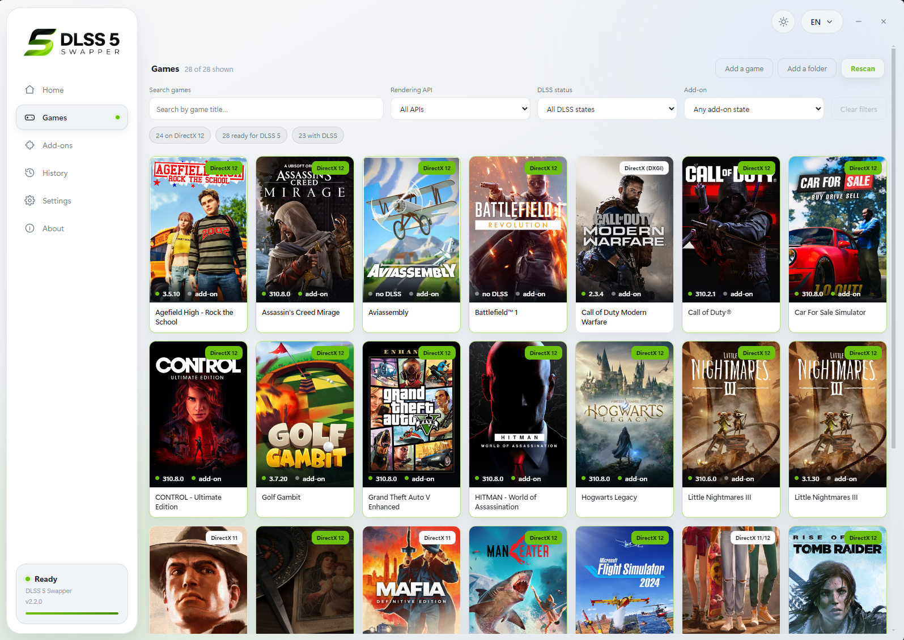
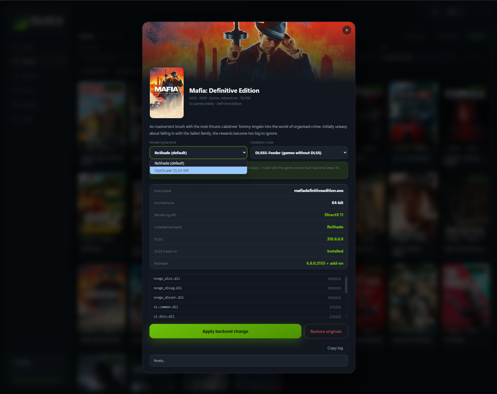
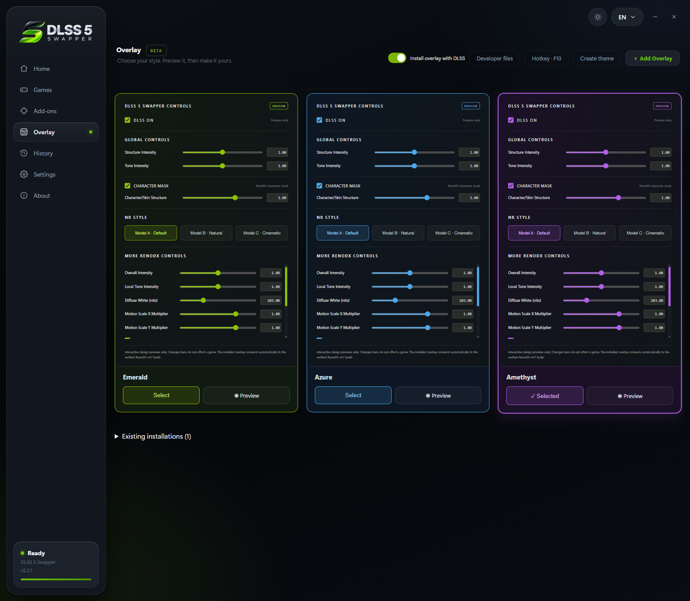

  

<h1 align="center">DLSS 5 Swapper</h1>

  为兼容的游戏与模拟器安装并管理 DLSS 5 神经渲染。

  <a href="README.en.md">English</a> · 简体中文

  
  
  
  

> ## ⚠️ 原作者已删库，这里是最后一版的保存
>
> 上游 `rakanki911/DLSS5-Swapper` 与作者账号 **已从 GitHub 删除**（现均返回 404）。本仓库保存的是原作者 **Rakan Alkhaldi** 发布的**最后一个版本 2.2.9**，在其基础上**只做了一件事：把界面汉化补到 100%**。功能、逻辑、依赖与行为**一律未改**，与作者最后一版完全一致。
>
> 正因如此，**它不只为中文用户准备**：任何语言的用户都可以把它当作原作者 v2.2.9 的一份存档来用，界面语言可在设置中切换（内置 38 种语言）。英文使用者请见 [README.en.md](README.en.md)。

  

## 下载

[**Windows 安装版**](https://github.com/CBEdwin/DLSS5-Swapper-zh-CN/releases/latest) ·
[**便携版**](https://github.com/CBEdwin/DLSS5-Swapper-zh-CN/releases/latest) ·
[校验和](https://github.com/CBEdwin/DLSS5-Swapper-zh-CN/releases/latest)

两者都在本仓库的 Release 页面，同目录下附有 `SHA256SUMS.txt`。

## 功能

- **安装简单：** 原生支持 DLSS 的游戏，或通过 DLSS5-Feeder 接入兼容的非 DLSS 游戏。
- **游戏库：** Steam、Epic、GOG、新版 Xbox Game Pass 目录，以及手动添加的游戏/模拟器。
- **搜索与筛选：** 标题、图形 API、DLSS 状态/版本和插件可组合筛选；点击计数即可筛选。
- **灵活布局：** 按商店分组或全部平铺为一张列表，带游戏封面与浅色/深色主题。
- **可控扫描：** 全盘扫描**默认关闭**。已添加的目录仍会正常扫描；可在设置里开启全盘发现，或移除扫描目录。
- **右键快捷操作：** 打开/复制目录、重新扫描、更换封面、还原原文件或隐藏游戏。
- **备份与历史：** 还原原始文件、保留安装记录、复制历史/活动/安装日志。
- **保存诊断：** 一个文件打包安装日志、游戏自身的 ReShade 与 Feeder 日志、清单和你的驱动信息 —— 写入前先给你过目，可直接附到反馈里。
- **游戏内叠加层：** 按 **F8** 在运行中的游戏上呼出本程序自己的面板，边玩边调真实的 DLSS 神经渲染滑块。仅支持 **DLSS5-Feeder** 与 **RenoDX** 两条路径，并且同时认得本程序附带的两个 RenoDX 版本（6.5.3 与更旧的 4.7）。拖住右下角把手可调整大小；每个游戏会各自记住自己的尺寸。
- **渲染 API 覆盖：** 可选、按游戏设置，默认 **自动**；自动检测的结果永远不会被覆盖。
- **自定义插件：** 在集成安装路径之外，插件页始终可用。
- **多通道神经渲染：** 一种安装路径，在 DX12、DX11 和 64 位 DX9 上每帧最多执行十次神经渲染 —— 包括本身没有 DLSS 的游戏。
- **社区（BETA）：** 看看别人的实测结果，范围收窄到你机器上的游戏和你用的显卡；提交你自己的报告，并在下方讨论。需主动开启，你留下的内容都可以编辑、删除或撤回。
- **社区聊天：** 所有使用者共用的一个实时聊天室 —— 截图、游戏卡片、带 @ 提及与表情回应。

## 2.2.9 新增

来自问题追踪器的四个故障，全部从根因上修复。每一个都有人在追踪器里报告过。

| | |
|---|---|
| **安装程序在打开前就崩溃** | 部分机器上安装程序会立刻以 `0xc0000005` 退出，无窗口、无提示，而便携版一切正常。安装框架读取 Windows 给出的路径时越界了。已在上游修复，本版本用的就是修好的版本（原上游问题 #344） |
| **文件还在游戏里，还原原文件却失效了** | 一次完成的还原会把备份记录改名归档，而所有判断「这个游戏是否装了东西」的逻辑只读当前那条记录。现在程序会找出文件仍在游戏里的最新一条已归档记录，并从同一份备份还原（原上游问题 #325） |
| **dgVoodoo2 被杀毒软件报毒** | 上游发布 2.87.5 正是因为杀毒引擎会报 2.87.4，而程序此前锁定的是 2.87.4（原上游问题 #390） |
| **被包装过的 DirectX 8/9 游戏里 ReShade 完全不启动** | 在 dgVoodoo 内部，游戏其实是一个 DirectX 11 程序，而部分环境只会加载 `d3d11.dll`。现在这些游戏也会提供 **ReShade file** 选项（原上游问题 #343、#374） |

## 更早的版本

每一版都有完整说明 —— 坏了什么、为什么、改了什么。

| | |
|---|---|
| **2.2.8** | [第二套主题，所有插件同步到最新](docs/releases/v2.2.8.md) —— 一整套全新设计、DLSS5-Feeder 1.17.0、RenoDX 6.5.3、每个游戏第二份 OptiScaler 构建，并修复十个故障 |
| **2.2.7** | [找到与你相关的那部分评测](docs/releases/v2.2.7.md) —— 按你的显卡筛选、只看你游戏库的评测、通知，并修复八个故障 |
| **2.2.6** | [社区聊天](docs/releases/v2.2.6.md) —— 所有人共用一个实时聊天室，每条路径都配上正确的插件 |
| **2.2.5** | [多通道](docs/releases/v2.2.5.md) —— 每帧最多十次神经渲染，另从根因修复九个故障 |
| **2.2.4** | [社区页](docs/releases/v2.2.4.md) —— 和其他人交流实测结果，另从根因修复八个故障 |
| **2.2.3** | [六个已报告的故障，从根因修复](docs/releases/v2.2.3.md) —— 老显卡上的 OptiScaler、游戏自带的过期着色器编译器、缩放显示下的叠加层 |
| **2.2.2** | [大家发来的报告](docs/releases/v2.2.2.md) —— 找不到的游戏、被拒绝的安装、叠加层自己的页面 |
| **2.2.1** | [叠加层页](docs/releases/v2.2.1.md) —— 可以自己写的主题，以及选之前先跑一遍的预览 |
| **2.2.0** | [可选的 OptiScaler 与更聪明的游戏库](docs/releases/v2.2.0.md) |

每个版本也都在 [Release 页面](https://github.com/CBEdwin/DLSS5-Swapper-zh-CN/releases)上带有自己的说明与下载。

## 兼容性

| 类别 | 支持情况 |
| --- | --- |
| **系统** | Windows 10/11 x64；兼容 32 位与 64 位游戏 |
| **ReShade / Feeder 显卡** | RTX 20 / 30 / 40 / 50；更早系列的支持情况由随附的修改版运行时作者给出 |
| **OptiScaler 显卡** | 已启用原生 DLSS 的 64 位游戏。随附的神经模型运行于 **Blackwell**（RTX 50 / RTX PRO Blackwell）；更老的显卡需要你自备改版 `nvngx_dlssnr.dll`，该文件永远不会被覆盖。驱动需 **616.56** 或更新 |
| **DirectX 12** | 原生 DLSS、Feeder，或符合条件的 OptiScaler 游戏 |
| **DirectX 11** | 32/64 位游戏走 Feeder；符合条件的 OptiScaler 游戏 |
| **DirectX 9 / 8** | DX9：32/64 位；DX8：32 位，经 dgVoodoo2 → DX11 → Feeder |
| **Vulkan / OpenGL** | ReShade/Feeder；符合条件的 Vulkan 游戏也可使用 OptiScaler |
| **DirectX 10** | Feeder 不直接支持；有 DX11 模式时请选 DX11 |
| **游戏内叠加层** | 支持 ReShade 插件接口的 64 位 DirectX 11 / 12 游戏；**仅限 DLSS5-Feeder 与 RenoDX** |

OptiScaler 的 DX11/Vulkan 路径默认使用 DX12 桥接并以 FSR 输出。
如需更改 Vulkan 后端，**请先还原原文件**。OptiScaler 不是模拟器/非 DLSS 游戏的那条路径。

## 模拟器

选择模拟器目录及其当前使用的渲染器，然后用 **ReShade/Feeder**。

<table>
  <tr><th colspan="3">模拟器</th></tr>
  <tr><td>DuckStation</td><td>PCSX2</td><td>RPCS3</td></tr>
  <tr><td>Dolphin</td><td>PPSSPP</td><td>Xenia</td></tr>
  <tr><td>Cemu</td><td>Ryujinx</td><td>yuzu / suyu / Eden / Citron / Sudachi</td></tr>
  <tr><td>shadPS4</td><td>Azahar / Citra / Lime3DS</td><td>melonDS</td></tr>
  <tr><td>Flycast</td><td>xemu</td><td>Vita3K</td></tr>
  <tr><td>RetroArch</td><td>mGBA</td><td>Snes9x</td></tr>
  <tr><td>Play!</td><td></td><td></td></tr>
</table>

兼容性因渲染器和游戏而异。Xenia 的 HUD 修正仍属实验性功能。

## 38 种语言

<table>
  <tr><th colspan="4">全部 38 种语言</th></tr>
  <tr><td>English</td><td>العربية</td><td>简体中文</td><td>繁體中文</td></tr>
  <tr><td>Español</td><td>Português</td><td>Русский</td><td>Deutsch</td></tr>
  <tr><td>Français</td><td>日本語</td><td>한국어</td><td>Italiano</td></tr>
  <tr><td>Türkçe</td><td>Polski</td><td>Українська</td><td>Nederlands</td></tr>
  <tr><td>Čeština</td><td>Magyar</td><td>Română</td><td>Ελληνικά</td></tr>
  <tr><td>Svenska</td><td>Dansk</td><td>Norsk</td><td>Suomi</td></tr>
  <tr><td>ไทย</td><td>Tiếng Việt</td><td>Bahasa Indonesia</td><td>Bahasa Melayu</td></tr>
  <tr><td>Filipino</td><td>हिन्दी</td><td>বাংলা</td><td>فارسی</td></tr>
  <tr><td>اردو</td><td>Български</td><td>Српски</td><td>Hrvatski</td></tr>
  <tr><td>Slovenčina</td><td>Català</td><td></td><td></td></tr>
</table>

**阿拉伯语、波斯语和乌尔都语支持从右到左布局。**

> **简体中文用户注意**：本仓库是独立维护的 v2.2.9 简体中文汉化版（非 fork，不受上游仓库变动影响）。上游的中文语言包实测覆盖率仅 16.5%（界面大量回退为英文），本仓库将其补全至 100%。改动说明、上游同步方式与许可归属详见 [TRANSLATION.zh-CN.md](TRANSLATION.zh-CN.md)。

## 截图

## 安装之前

- **反作弊：** 红色警告加可选确认，而不是一刀切拦截。注入可能导致崩溃或封号；本程序不会绕过反作弊。
- **运行要求：** Feeder 需要 Visual C++ 运行库（x64，32 位游戏另需 x86）。部分组件在首次使用时下载。
- **不保证兼容。** 请保留备份；已有 Mod 可能冲突。并非每一个被报告的崩溃都已修复。
- **Linux/Proton：** 仅有实验性的社区源码；本版本不含 Linux 二进制。

## 社区与隐私

- 打开社区页会下载公开的游戏报告。在线连接数只保存在内存中，不存储任何连接标识。
- 只有在你查看并提交对话框中的字段后，报告才会发出：游戏、路径、渲染 API、结果、可选评论、GPU、驱动、CPU、系统与应用版本。
- 程序使用一个随机的安装 ID 来防止重复投票，服务器只保存它的哈希。**移除我的社区活动** 会隐藏你的全部报告与回复，并重置你的公开社区资料。
- 仅限所有者使用的管理员访问码由社区服务器校验，并在本地以 Windows 加密存储保存。它永远不会写入公开资料或普通的社区设置文件。

---

由 **Rakan Alkhaldi** 制作 · MIT · [第三方组件与许可](THIRD_PARTY_NOTICES.md)

本仓库仅保存其 v2.2.9 最后一版并补全简体中文翻译，不改动功能。原作者账号与上游仓库均已删除，如有版权问题请联系本仓库删除。
