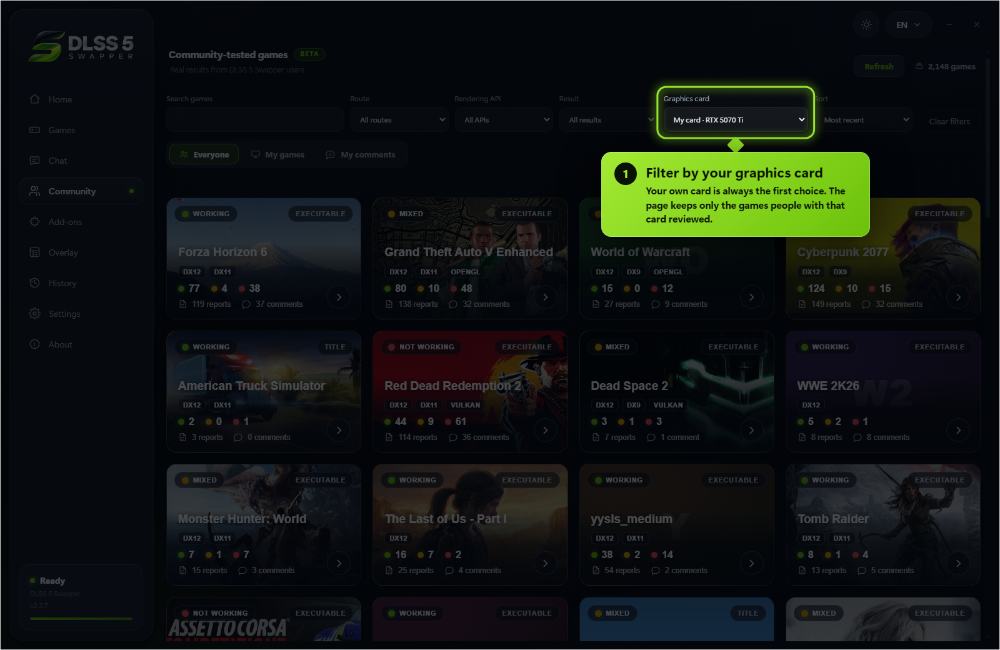
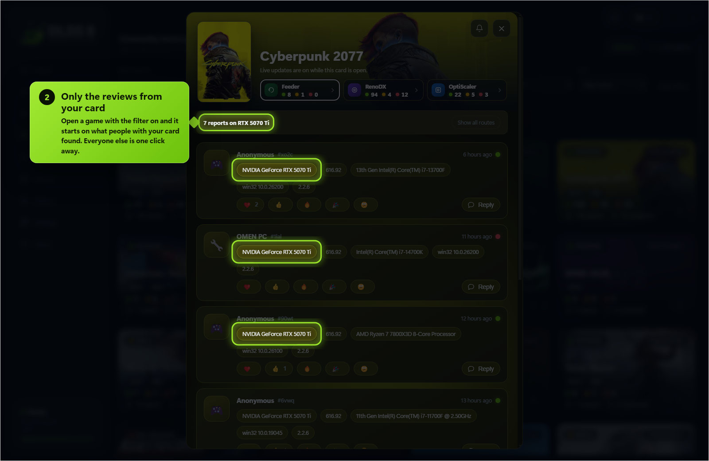
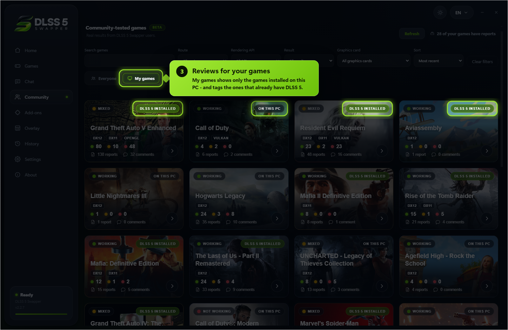
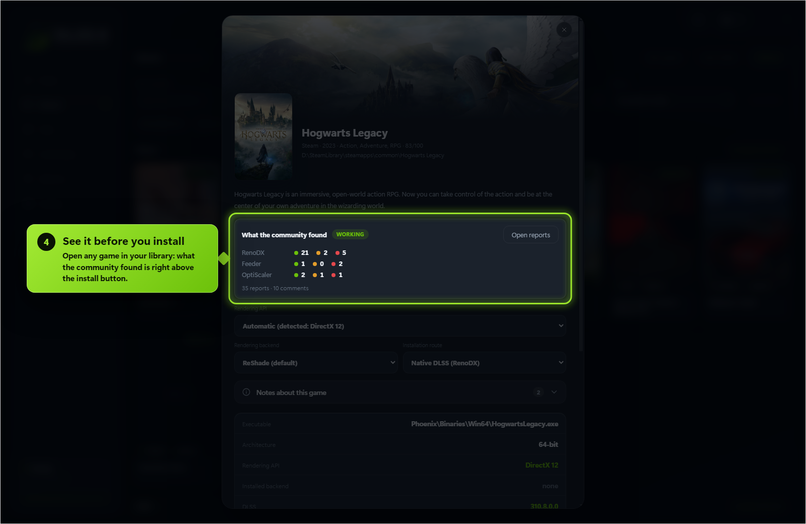

# DLSS 5 Swapper v2.2.7 — Find the reviews that matter to you

Find the reviews that matter to you, hear about it when people answer you - and every fix promised on the tracker.

### ✨ New

**1 · Filter by your graphics card** - pick your card in the Community filter and see only the reviews from people with that same card. Your own card is always the first choice.

**2 · Only the reviews from your card** - open any game with the filter on, and it starts on what people with your card found. Everyone else is one click away.

**3 · Reviews for your games** - switch to **My games** and the page shows only the games installed on your PC, tagged when DLSS 5 is already in them.

**4 · See it before you install** - open any game in your library: what the community found for it is right above the install button.

Also new: **My comments** (everything you reported, in one place), **Sort** by most recent, most reports or A-Z, API tags on every card (upstream #288), and **notifications** when someone mentions you in the chat, replies to you there, or reacts to your review or your message.

### 🔧 Fixed

| | |
|---|---|
| **DirectDraw never installed** | dgVoodoo was downloaded only for DX8 and DX9, so every DirectDraw game failed with `errDgVoodooMissing` - Gens and the other emulators included (upstream #292, upstream #279, upstream #150) |
| **Prey, Titanfall 2, Call of Duty 2 and Max Payne read as "No 3D executable"** | Their renderer is a DLL beside the executable. A Direct3D library in the executable's own folder is now enough to offer it (upstream #259, upstream #249) |
| **Portal was filed under Half-Life 2** | Both run `hl2.exe`, and no report ever carried the store id it should have. An executable many games share - `hl2.exe`, every emulator - no longer decides which card a report lands on (upstream #274) |
| **The read-only ReShade.ini banner came back** | 2.2.5 cleared it only when a game was opened in the app. Every game this app installed into is checked once each time it starts (upstream #155) |
| **Games under Program Files failed with `EPERM`** | Windows protects that folder. The install now says so up front, in words: run as administrator, or move the game (upstream #301) |
| **The driver warning read like a wall** | It is a warning: many people run newer drivers without trouble, especially with MSI Afterburner and RivaTuner closed. It says so now (upstream #300, upstream #278) |
| **"DLSS was installed normally" before it was** | The overlay message appeared before the install finished, even when it then failed (upstream #275) |
| **Uninstalling left ReShade in games** | Uninstalling never touches game folders. The uninstaller now says so and points to **Restore originals** first (upstream #266) |

upstream #150:
upstream #155:
upstream #249:
upstream #259:
upstream #266:
upstream #274:
upstream #275:
upstream #278:
upstream #279:
upstream #288:
upstream #292:
upstream #300:
upstream #301:
